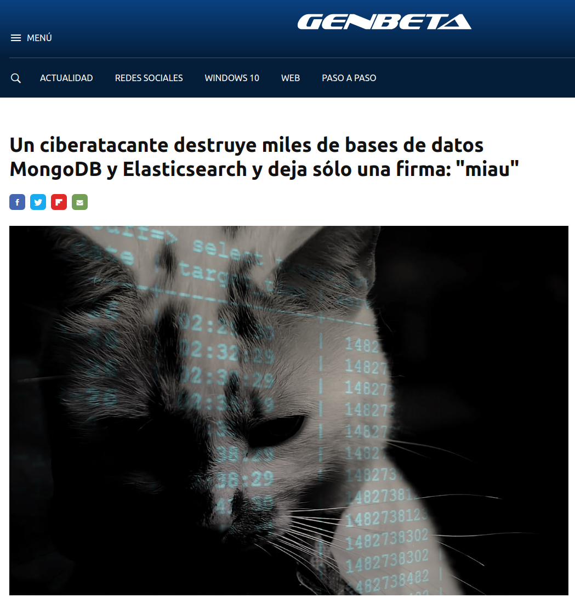
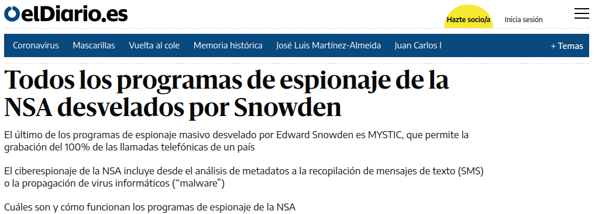
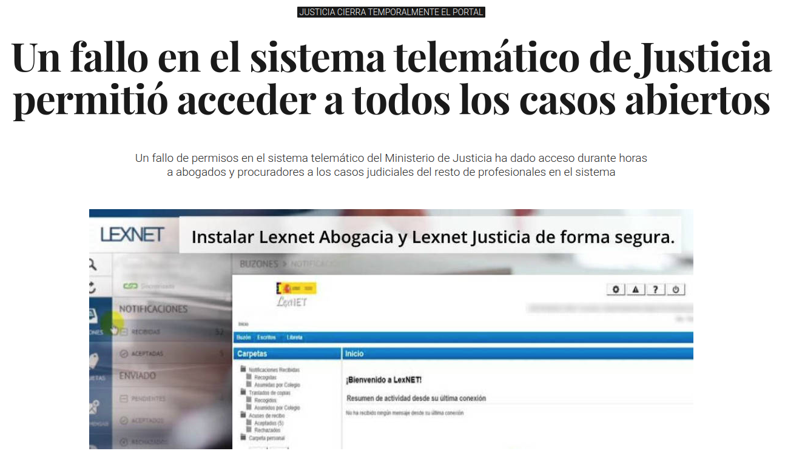
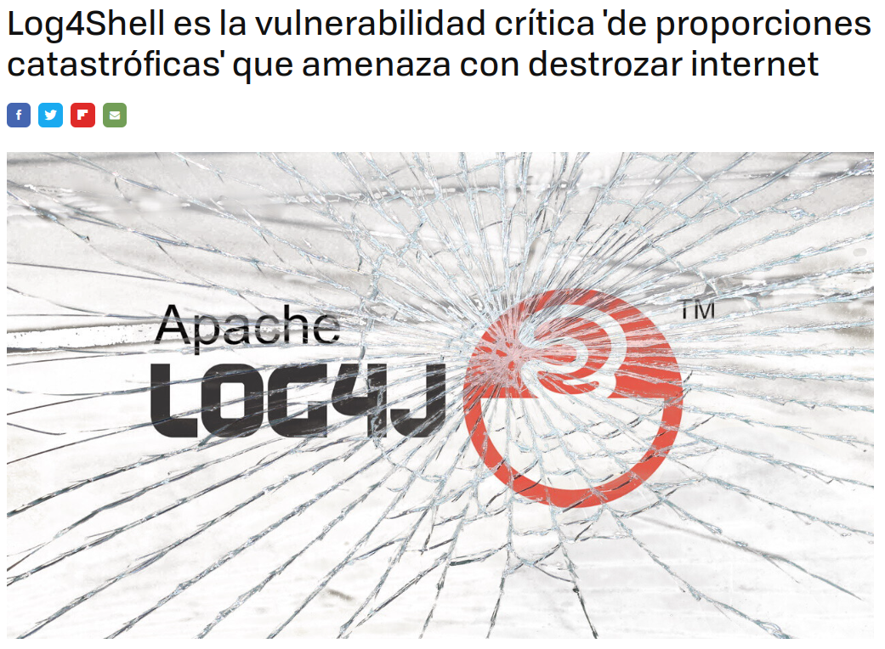
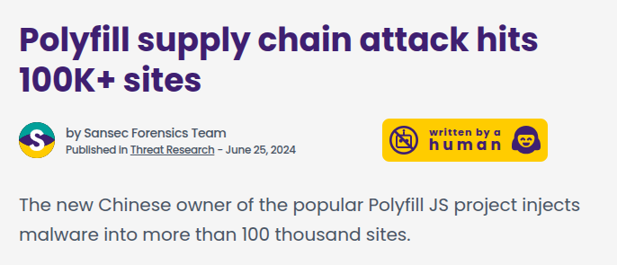
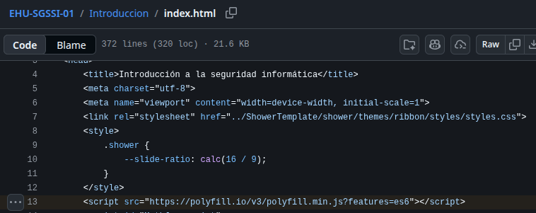
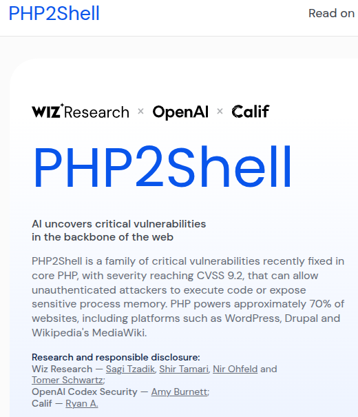
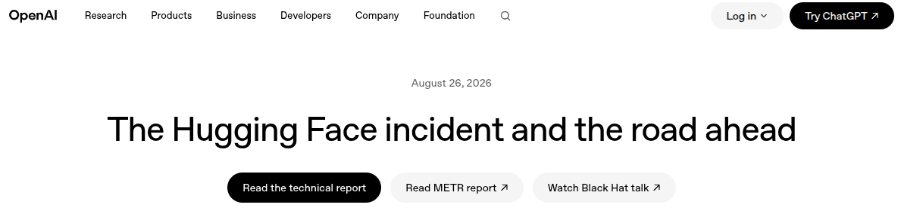
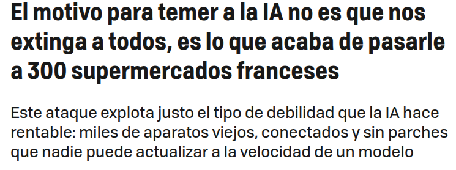

# Introducción a SGSSI

[GitHub/EHU-SGSSI-01/Introducción](https://github.com/mikel-egana-aranguren/EHU-SGSSI-01/tree/main/Introduccion)

Mikel Egaña Aranguren

---

TODO: definicion

---

TODO: proceso

--- 

No TODO: responsables

--- 

# Principios

* Confidencialidad
* Integridad
* Disponibilidad
* Autenticidad
* No repudio

---

# Principios: Confidencialidad

> Se garantiza que la información transmitida o almacenada en un sistema informático sólo podrá ser leída por su legítimo destinatario. 

> Si dicha información cae en manos de terceras personas no podrán acceder al contenido original

--- 

# Principios: Integridad

> Se garantiza que la información no ha sido modificada desde su creación o durante su transmisión

> Permite detectar si se ha añadido, modificado o eliminado parte de la información almacenada, procesada o transmitida

---

# Principios: Disponibilidad

> La información debe estar disponible para sus legítimos usuarios y propietarios

> Se garantiza el correcto funcionamiento del sistema informático mediante un diseño suficientemente robusto frente a ataques e interferencias

---

# Principios: Autenticación

> Se puede comprobar la identidad del usuario que crea o accede a la información

> También se habla de autenticación de un equipo que se conecta a una red o intenta acceder a un servicio

---

# Principios: No repudio

> Se demuestra la autoría de la información mediante un mecanismo probatorio que impida al usuario que la ha creado y enviado negar esta circunstancia

> Se aplica la misma situación al destinatario de la información

> Especialmente importante en transacciones comerciales

---

# Ejemplos: Wannacry

  

##

##

[«iuqerfsodp9ifjaposdfjhgosurijfaewrwergwea.com»: cuando un dominio de 10 dólares frenó una pandemia digital](https://teknoplof.com/2026/06/02/iuqerfsodp9ifjaposdfjhgosurijfaewrwergwea-com-cuando-un-dominio-de-10-dolares-freno-una-pandemia-digital/)

---

# Ejemplos: Miau

  

##

##

[Un ciberatacante destruye miles de bases de datos MongoDB y Elasticsearch y deja sólo una firma: "miau"](https://www.genbeta.com/seguridad/ciberatacante-destruye-miles-bases-datos-mongodb-elasticsearch-deja-solo-firma-miau)

---

# Ejemplos: Ransomware Navarra

 

[Los ayuntamientos navarros llevan 13 días caídos: un ransomware ha dejado a toda la administración como hace 20 años](https://www.genbeta.com/actualidad/ayuntamientos-navarros-llevan-13-dias-caidos-ransomware-ha-dejado-a-toda-administracion-como-hace-20-anos)

---

# Ejemplos: espionaje NSA

  

##

##

Vigilancia permanente. Edward Snowden. Grupo Planeta, 2019

> "Quien renuncia a su libertad por seguridad, no merece ni libertad ni seguridad" B. Franklin

---

# Ejemplos: Lexnet

---

# Ejemplos: Salud

---

# Ejemplos: Tesla

---

# Ejemplos: LOG4Shell

---

# Ejemplos: Polyfill Supply Chain Attack

  

##

##

---

# Ejemplos: (IA) PHP2Shell

---

# Ejemplos: (IA) OpenAI Hugging face

---

# Ejemplos: (IA - Guerra hibrida) Supermercados Francia

---

# TODO: 

fuentes de informacion, modelo seguridad, ...
