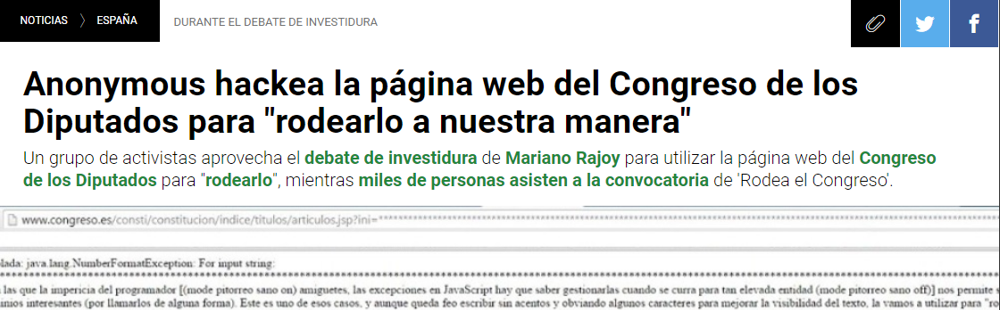
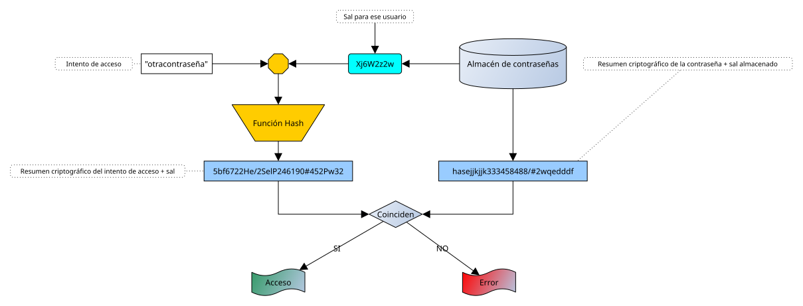

# Your slide deck

Start writing

---

The second page also has same color.

---



--- 


* list 1
* list 2

---

## Lol

### Lol

> aaaa

> aaaa

---

```
code code
code

code
```

---

# Link !!!!

[EHU-SGSSI-01/Introduccion](https://github.com/mikel-egana-aranguren/EHU-SGSSI-01/blob/main/Introduccion/index.html.md5sum)

---

# SVG?



Crea una carpeta llamada `Backups` en el directorio /var/tmp.